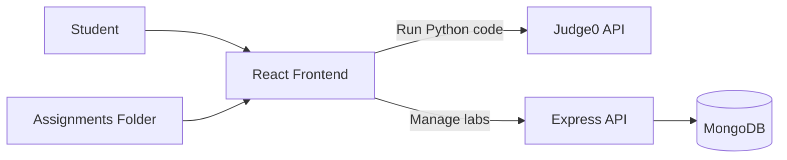

# PyStatLab

<div align="center">
  
  <p><strong>Computational Statistics Using Python</strong></p>
  <p>My 3rd semester subject repository for Computational Statistics, with assignments and an interactive full-stack lab platform.</p>
  <p>
    
    
    
    
    
    
  </p>
</div>

## Quick Links

- [Overview](#overview)
- [Academic Context](#academic-context)
- [Architecture](#architecture)
- [Feature Highlights](#feature-highlights)
- [Repository Layout](#repository-layout)
- [Quick Start](#quick-start)
- [API Endpoints](#api-endpoints)
- [Contributing](#contributing)
- [License](#license)

## Overview

This repository combines three pieces of work:

| Component | Purpose | Tech |
| --- | --- | --- |
| `Assignments/` | Topic-wise Python assignments for computational statistics | Python |
| `computational-statistics/` | Interactive web interface for learning, labs, and Python code execution | React 19, Vite, Tailwind, Monaco |
| `computational-statistics-backend/` | Assignment CRUD API for the Labs module | Node.js, Express, MongoDB |

## Academic Context

This is my **3rd semester subject repository** for **Computational Statistics**. It documents my coursework, practical Python assignments, and the companion web platform I built to practice and present core statistical computing concepts.

## Architecture



## Feature Highlights

### Web Platform

| Module | What it does |
| --- | --- |
| Landing (`/`) | Presents project overview with animated sections |
| Compiler (`/compiler`) | Runs Python code through Judge0 and supports stdin input |
| Labs (`/labs`) | Displays assignments from backend, includes admin create/edit/delete flows |
| Learn (`/learn`) | Curated pathways, resources, and guided learning sections |

### Coursework Coverage

| Topic Folder | Focus Area |
| --- | --- |
| `Assignments/Python Basics` | Language fundamentals |
| `Assignments/Python Strings` | String operations |
| `Assignments/Python Function` | Functions and parameters |
| `Assignments/Python Module` | Module creation and imports |
| `Assignments/Loop List` | Iteration and list logic |
| `Assignments/2D List` | Matrix-style data handling |
| `Assignments/Calculation of Mean, Variance, Co-variance & Relational Matrix` | Core descriptive statistics and relation matrices |
| `Assignments/Comparative study of distance` | Distance measure comparison |
| `Assignments/Scatter Plot` | Visualization practice |

## Repository Layout

```text
Computational-Statistics-using-Python/
|-- Assignments/
|-- computational-statistics/
|   |-- public/
|   |-- src/
|   |   |-- components/
|   |   `-- pages/
|   |-- package.json
|   `-- vite.config.js
|-- computational-statistics-backend/
|   |-- models/
|   |-- server.js
|   `-- package.json
|-- CONTRIBUTING.md
|-- LICENSE
`-- README.md
```

## Quick Start

### Prerequisites

- Node.js 18+
- npm 9+
- Python 3.x
- MongoDB (local or cloud URI)
- RapidAPI key for Judge0

### 1) Clone

```bash
git clone <your-repo-url>
cd Computational-Statistics-using-Python
```

### 2) Configure Environment Variables

Create `computational-statistics/.env`:

```bash
VITE_FRONTEND_URL=http://localhost:5001
VITE_ADMIN_PIN=1234
VITE_API_KEY=your_rapidapi_key
```

Create `computational-statistics-backend/.env`:

```bash
MONGODB_URI=mongodb://localhost:27017/cpp-labs
PORT=5001
NODE_ENV=development
```

### 3) Install and Run

Start backend:

```bash
cd computational-statistics-backend
npm install
node server.js
```

Start frontend in a second terminal:

```bash
cd computational-statistics
npm install
npm run dev
```

Open `http://localhost:5173`.

### 4) Run Assignment Scripts

```bash
python "Assignments/Calculation of Mean, Variance, Co-variance & Relational Matrix/1.py"
```

## API Endpoints

Base URL: `http://localhost:5001/api`

| Method | Endpoint | Purpose |
| --- | --- | --- |
| `GET` | `/python-assignments` | List all assignments |
| `POST` | `/python-assignments` | Create assignment |
| `GET` | `/python-assignments/:id` | Fetch one assignment |
| `PUT` | `/python-assignments/:id` | Replace assignment |
| `PATCH` | `/python-assignments/:id/edit` | Partial update |
| `DELETE` | `/python-assignments/:id` | Delete assignment |
| `GET` | `/health` | Service health check (outside `/api`) |

## Contributing

Please read [CONTRIBUTING.md](CONTRIBUTING.md) before opening a pull request.

## License

This project is licensed under the MIT License. See [LICENSE](LICENSE).
